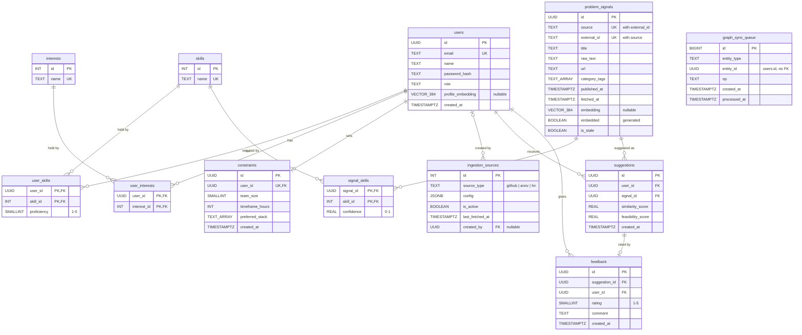

# Brew — Database Design

Brew stores data in three ways:

- **PostgreSQL**, the relational source of truth: users, skills, interests, signals, suggestions, and feedback.
- **pgvector**, inside the same Postgres instance, for embeddings and nearest-neighbour search.
- **Neo4j**, a read-optimized mirror of users, skills, and interests, plus collaboration history, used for teammate matching.

Source files:

| File | Contents |
|---|---|
| [`db/postgres/schema.sql`](../db/postgres/schema.sql) | Tables, indexes, functions, triggers, materialized view, reference data |
| [`db/postgres/seed.sql`](../db/postgres/seed.sql) | Demo data: 10 users, 31 signals |
| [`db/neo4j/constraints_and_seed.cypher`](../db/neo4j/constraints_and_seed.cypher) | Graph constraints and matching demo data |
| [`db/neo4j/queries/teammates.cypher`](../db/neo4j/queries/teammates.cypher) | Teammate recommendation query |

## 1. Entity-relationship diagram



`graph_sync_queue` has no foreign keys on purpose (see [section 7](#7-graph-sync-outbox)). `feedback (suggestion_id, user_id)` is a composite foreign key to `suggestions (id, user_id)`.

## 2. Tables

### Identity and profile

- **`users`**: one row per account.
  - `password_hash` holds a bcrypt or argon2 hash for the NextAuth credentials provider, never the plain password.
  - `profile_embedding` caches an embedding of the user's skills and interests. It uses the same model and 384 dimensions as signal embeddings, so the two can be compared directly. It is NULL until first computed.
- **`skills`** and **`interests`**: controlled vocabularies.
  - Interest names also serve as the vocabulary for `problem_signals.category_tags`.
  - Both are seeded in `schema.sql` because the app needs them in every environment.
- **`user_skills`**: many-to-many link between users and skills, with `proficiency` from 1 to 5.
- **`user_interests`**: many-to-many link between users and interests. Postgres is the source of truth; Neo4j mirrors it.
- **`constraints`**: the user's planning limits, `team_size` and `timeframe_hours`. `UNIQUE (user_id)` allows exactly one row per user, because the scorer needs a single answer to "how big is this user's team?".

### Ingestion

- **`ingestion_sources`**: curator-managed configuration per source type (`github`, `arxiv`, `hn`). `config` is source-specific JSON, such as labels, arXiv categories, or minimum points.
- **`problem_signals`**: one row per ingested item.
  - `(source, external_id)` is the natural key used for upserts.
  - `category_tags` holds broad topics only, such as `climate` or `healthtech`.
  - `embedding` is filled in by the embedding job. `embedded` is a generated column, `embedding IS NOT NULL`.
  - `is_stale` excludes the signal from suggestions without deleting it.
- **`signal_skills`**: many-to-many link between signals and the skills they require. `confidence` (0 to 1) records how sure the tagger is about each one. Skills used to be mixed into `category_tags` as free text. This table gives them referential integrity and lets the scorer join on integer keys.

### Recommendations

- **`suggestions`**: a signal shown to a user, with the similarity and feasibility scores at the time it was shown. `UNIQUE (user_id, signal_id)` means re-scoring updates the existing row instead of adding a duplicate.
- **`feedback`**: a user's rating of a suggestion they received.
  - `UNIQUE (user_id, suggestion_id)` allows one rating per suggestion.
  - The composite foreign key guarantees that the rater is the user the suggestion was made to.

### Sync

- **`graph_sync_queue`**: the transactional outbox that feeds Neo4j (see [section 7](#7-graph-sync-outbox)).

## 3. Normalization

### First normal form

Every column holds one value per row, except the two array columns:

- **`problem_signals.category_tags`** is a deliberate exception. Tags are only filtered with `@>` (GIN-indexed) and unnested for the trending view. They are never joined to another table and carry no attributes of their own. The CHECK constraint forbids NULL elements.
  - The data that *does* need integrity and attributes, the skills a signal requires, was moved into `signal_skills`.
  - If tags ever need attributes, they can move into a junction table on `interests`.
- **`constraints.preferred_stack`** is free-text display preference that is never queried relationally. It is the same trade-off.

`ingestion_sources.config` (JSONB) is treated as one opaque value. Postgres never queries inside it; only the ingestion adapter interprets it.

### Functional dependencies and keys

| Table | Candidate keys | Non-trivial FDs | Normal form |
|---|---|---|---|
| `users` | `id`, `email` | `id → everything`; `email → everything` | BCNF |
| `skills` / `interests` | `id`, `name` | `id ↔ name` | BCNF |
| `user_skills` | `(user_id, skill_id)` | `(user_id, skill_id) → proficiency` | BCNF |
| `user_interests` | `(user_id, interest_id)` | none (all-key) | BCNF |
| `constraints` | `id`, `user_id` | either key → the rest | BCNF |
| `ingestion_sources` | `id` | `id → the rest` | BCNF |
| `problem_signals` | `id`, `(source, external_id)` | either key → the rest | BCNF (see below) |
| `signal_skills` | `(signal_id, skill_id)` | `→ confidence` | BCNF |
| `suggestions` | `id`, `(user_id, signal_id)` | either key → the rest | BCNF |
| `feedback` | `id`, `(user_id, suggestion_id)`, `suggestion_id` | see below | BCNF |
| `graph_sync_queue` | `id` | `id → the rest` | BCNF |

Every determinant in every table is a candidate key, so the schema is in BCNF, and therefore also 3NF. The cases that need a closer look:

- **`feedback.user_id`.** `suggestion_id → user_id` holds, because a suggestion belongs to one user. Since there can be only one feedback row per `(user_id, suggestion_id)`, `suggestion_id` on its own is also a candidate key of `feedback`. The FD therefore comes from a key, and BCNF holds within the table.
  - The remaining risk is that `feedback.user_id` and `suggestions.user_id` disagree. The composite foreign key `(suggestion_id, user_id) → suggestions (id, user_id)` makes that impossible.
  - The duplicated column buys a single-table "all feedback by user X" query.
- **`problem_signals.embedded`** would be a transitive dependency (`embedding → embedded`) if it were stored independently. It is now `GENERATED ALWAYS AS (embedding IS NOT NULL)`, so it can never be updated on its own or disagree with `embedding`.
- **`problem_signals.is_stale`** is *not* derivable from the dates. Curators can mark a fresh signal stale by hand, so it is an independent fact.
- **Computed caches.** `problem_signals.embedding` and `users.profile_embedding` are model outputs computed outside the database. `suggestions.*_score` are snapshots taken when the suggestion was made. Each depends only on its row's key in the stored schema; we don't model "same text → same vector" as a business rule. They are documented caches that the application refreshes.

## 4. Indexes

Every index, including those created implicitly by primary keys and unique constraints:

| Table | Index | Type | Why it exists |
|---|---|---|---|
| `users` | PK `id` | B-tree | Row lookup; FK target |
| `users` | UNIQUE `email` | B-tree | Login lookup; one account per email |
| `skills`, `interests` | PK `id`, UNIQUE `name` | B-tree | FK target; name lookups when seeding and syncing |
| `user_skills` | PK `(user_id, skill_id)` | B-tree | "Skills of user X"; the scorer's per-skill probe |
| `user_skills` | `idx_user_skills_skill (skill_id)` | B-tree | "Users with skill X"; stops `ON DELETE CASCADE` from `skills` scanning the table |
| `user_interests` | PK `(user_id, interest_id)` | B-tree | "Interests of user X" |
| `user_interests` | `idx_user_interests_interest (interest_id)` | B-tree | Reverse lookup; cascade from `interests` |
| `constraints` | PK `id`, UNIQUE `user_id` | B-tree | One row per user; the scorer's lookup |
| `problem_signals` | PK `id` | B-tree | `id = ANY($ids)` in `score_candidates`; FK target |
| `problem_signals` | UNIQUE `(source, external_id)` | B-tree | Dedupe target for `INSERT ... ON CONFLICT` |
| `problem_signals` | `idx_problem_signals_embedding` | HNSW (`vector_cosine_ops`) | Approximate nearest-neighbour search with `<=>` |
| `problem_signals` | `idx_problem_signals_freshness (fetched_at DESC)` | B-tree | Trending view's 14-day window; recent-signal lists |
| `problem_signals` | `idx_problem_signals_category` | GIN | `category_tags @> ARRAY[...]` topic filters |
| `problem_signals` | `idx_problem_signals_unembedded (fetched_at) WHERE NOT embedded` | Partial B-tree | Embedding job takes oldest-first batches; holds only the backlog |
| `problem_signals` | `idx_problem_signals_stale_candidates (COALESCE(published_at, fetched_at)) WHERE is_stale = false` | Partial expression B-tree | Staleness sweep reads only not-yet-stale rows past the cutoff |
| `signal_skills` | PK `(signal_id, skill_id)` | B-tree | "Skills required by signal X" in the scorer |
| `signal_skills` | `idx_signal_skills_skill (skill_id)` | B-tree | "Signals needing skill X"; cascade from `skills` |
| `suggestions` | PK `id` | B-tree | Row lookup |
| `suggestions` | UNIQUE `(user_id, signal_id)` | B-tree | No duplicate suggestions; "suggestions for user X" |
| `suggestions` | UNIQUE `(id, user_id)` | B-tree | Target of feedback's composite FK; Postgres requires a unique index on the referenced columns |
| `suggestions` | `idx_suggestions_signal (signal_id)` | B-tree | Cascade from `problem_signals` |
| `feedback` | PK `id` | B-tree | Row lookup |
| `feedback` | UNIQUE `(user_id, suggestion_id)` | B-tree | One rating per suggestion. Also serves "feedback by user X", the cascade from `users`, and the composite-FK cascade from `suggestions` (equality on both columns) |
| `graph_sync_queue` | PK `id` | B-tree | Row lookup |
| `graph_sync_queue` | `idx_graph_sync_queue_pending (id) WHERE processed_at IS NULL` | Partial B-tree | The worker's poll; processed history stays out of it |
| `trending_problem_areas` | `idx_trending_problem_areas_category` UNIQUE | B-tree | Required for `REFRESH MATERIALIZED VIEW CONCURRENTLY` |

**HNSW rather than IVFFlat.** IVFFlat clusters vectors around centroids chosen from the rows present at build time. Built on an empty table, as it is when `schema.sql` runs, those centroids are meaningless, and recall stays poor until someone runs `REINDEX`. HNSW has no training step and stays accurate as rows arrive. The trade-offs are slower inserts and more memory, both negligible at Brew's scale.

Recall can be tuned per session with `SET hnsw.ef_search = 100;` (the default is 40). Queries that also filter (for example `WHERE is_stale = false`) can return fewer than `LIMIT` rows, because filtering happens after the index scan. On pgvector 0.8+, `SET hnsw.iterative_scan = relaxed_order;` fixes this.

`users.profile_embedding` is not indexed. It is used as the *query* vector against signals, never searched itself.

## 5. Functions

### `score_candidates(p_user_id UUID, p_signal_ids UUID[]) → TABLE(signal_id, score)`

This function scores the whole shortlist returned by vector search in one set-based query. It replaces one function call per candidate, each doing three lookups.

```
score = skill_coverage × team_factor × time_factor            ∈ [0, 1]

skill_coverage = Σ (proficiency / 5) over required skills the user has
                 ÷ number of skills the signal requires
               = 0.5 if the signal has no tagged skills (neutral)
team_factor    = min(1, 0.6 + 0.1 × team_size)     solo 0.7 … 4+ people 1.0
time_factor    = 0.85 if timeframe_hours < 24, else 1.0
```

- A user with no `constraints` row gets the defaults: a team of 1 and 48 hours.
- Unknown signal IDs are dropped from the result.
- The function is declared `STABLE`: it reads tables but never writes, so it is safe to call inside any query.

Example from the seed data: Sofia (llm 5, nlp 5, vector-search 4; team of 2, 18 hours) on the clinical-RAG paper, which requires llm, nlp, and vector-search, scores `(1 + 1 + 0.8)/3 × 0.8 × 0.85 = 0.635`.

Typical call:

```sql
SELECT ps.*, sc.score
FROM score_candidates($1, $2::uuid[]) sc
JOIN problem_signals ps ON ps.id = sc.signal_id
ORDER BY sc.score DESC;
```

### `compute_feasibility_score(p_user_id, p_signal_id) → REAL`

A one-line wrapper around `score_candidates` for ad-hoc queries and readability. Application code should not loop over it.

### `expire_stale_signals() → INTEGER`

Marks signals stale once `COALESCE(published_at, fetched_at)` is more than 30 days old and returns the number of rows changed.

- It uses `published_at` because a year-old paper that was fetched today is not fresh.
- Its `WHERE` clause matches the partial index exactly, so it reads only not-yet-stale rows past the cutoff and never rewrites rows that are already stale.
- A scheduled job can call it with `SELECT expire_stale_signals();`.

## 6. Triggers and views

| Trigger | When | What it does |
|---|---|---|
| `trg_set_signal_staleness` | `BEFORE INSERT OR UPDATE OF published_at, fetched_at` on `problem_signals`, per row | Sets `NEW.is_stale` if the incoming row is already past the cutoff, for example a backfilled paper. Fires only when a relevant date is written; needs no second `UPDATE`. |
| `trg_sweep_stale_signals` | `AFTER INSERT` on `problem_signals`, per statement | Calls `expire_stale_signals()` to catch *existing* rows that aged out since the last run. Usually an empty index range scan. |
| `trg_users_graph_sync` | `AFTER INSERT OR DELETE` on `users` | Enqueues a `user` event. |
| `trg_users_graph_sync_name` | `AFTER UPDATE OF name` on `users`, `WHEN` the name actually changed | Enqueues a `user` event. Password, email, role, and embedding updates are ignored because Neo4j doesn't store them. |
| `trg_user_skills_graph_sync` | `AFTER INSERT/UPDATE/DELETE` on `user_skills` | Enqueues a `user_skill` event for the affected user, or both users if a row moved between users. |
| `trg_user_interests_graph_sync` | `AFTER INSERT/UPDATE/DELETE` on `user_interests` | Same, with `user_interest`. |

Staleness only ever goes from not stale to stale. Nothing sets `is_stale` back to `false`, so a signal a curator retired by hand stays retired even if it is re-fetched.

**`trending_problem_areas`** (materialized view) counts non-stale signals per topic tag fetched in the last 14 days, along with the most recent fetch time. It has a unique index on `category`, so it can be refreshed without blocking readers:

```sql
REFRESH MATERIALIZED VIEW CONCURRENTLY trending_problem_areas;
```

Run this after each ingestion job. The view has no `ORDER BY`; sort when querying it.

## 7. Graph sync outbox

Neo4j mirrors users, skills, and interests from Postgres. Writing to both databases from the app would risk them drifting apart whenever one write succeeds and the other fails. Instead, triggers write an event to `graph_sync_queue` **in the same transaction** as the change. An event exists if and only if the change committed.

A sync worker drains the queue:

1. `SELECT … FROM graph_sync_queue WHERE processed_at IS NULL ORDER BY id FOR UPDATE SKIP LOCKED LIMIT n`. `SKIP LOCKED` lets several workers run safely, and the query uses `idx_graph_sync_queue_pending`.
2. For each distinct `entity_id` (always a `users.id`), it re-reads that user's *current* name, skills, and interests from Postgres.
   - If the user no longer exists, it runs `DETACH DELETE` on the `(:User)` node.
   - Otherwise it `MERGE`s the node and replaces its `HAS_SKILL` and `INTERESTED_IN` edges.
3. `UPDATE … SET processed_at = now()` for the batch.

Because step 2 copies current state rather than replaying each change, it is **idempotent**. Events can arrive late, twice, or be collapsed per user without the graph drifting.

`entity_id` has no foreign key so that delete events survive the user row being deleted. Deleting a user produces one `user` event plus one event for each cascaded skill or interest row, and the worker collapses them per user.

Limitations to be aware of:

- `TRUNCATE` does not fire row triggers.
- Renaming a skill or interest is not synced. Those vocabularies change rarely and are seeded identically in both stores.
- `COLLABORATED_WITH` edges exist only in Neo4j, because Postgres has no collaborations table yet.

## 8. Neo4j

**Constraints.** There are uniqueness constraints on `User.id`, `Skill.name`, and `Interest.name`. Each is backed by an index, so there is no separate index on `User.id`.

**Teammate query** ([`queries/teammates.cypher`](../db/neo4j/queries/teammates.cypher)). The only filter is that a candidate must bring at least one skill the user lacks. Everything else adjusts the score:

| Signal | Weight |
|---|---|
| Complementary skill (they have it, I don't) | +2.0 each |
| Overlapping skill | −0.5 each |
| Shared interest | +1.5 each |
| Mutual collaborator (2-hop: worked with someone I've worked with) | +1.0 each, max 3 |
| Direct past collaborator | +1.0 |

Shared interests used to be required for someone to appear at all. Now they only boost the score, so a strong skill match with different interests still shows up.

The query returns the reasons alongside the score (`complementarySkills`, `sharedInterests`, `mutualCollaborators`) so the UI can explain each recommendation. For example, with the seed data, Hana appears for Aisha via their mutual collaborator Sofia.

## 9. Loading the schema and seed data

```bash
psql "$DATABASE_URL" -f db/postgres/schema.sql
psql "$DATABASE_URL" -f db/postgres/seed.sql
```

For Neo4j, run `db/neo4j/constraints_and_seed.cypher` in Neo4j Browser or with `cypher-shell -f`. Then run the teammate query with parameters, for example:

```
:param userId => '00000000-0000-4000-8000-000000000001'
:param limit => 10
```
